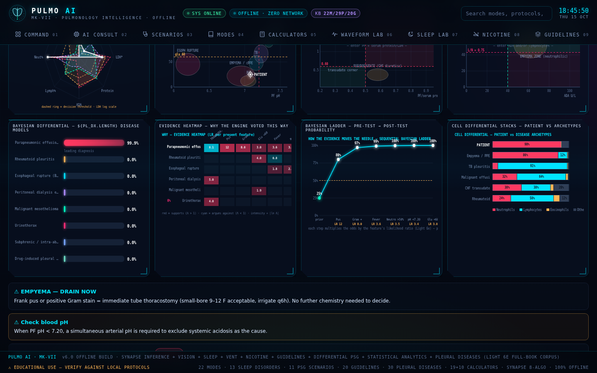
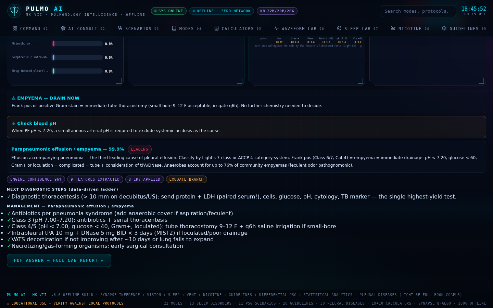
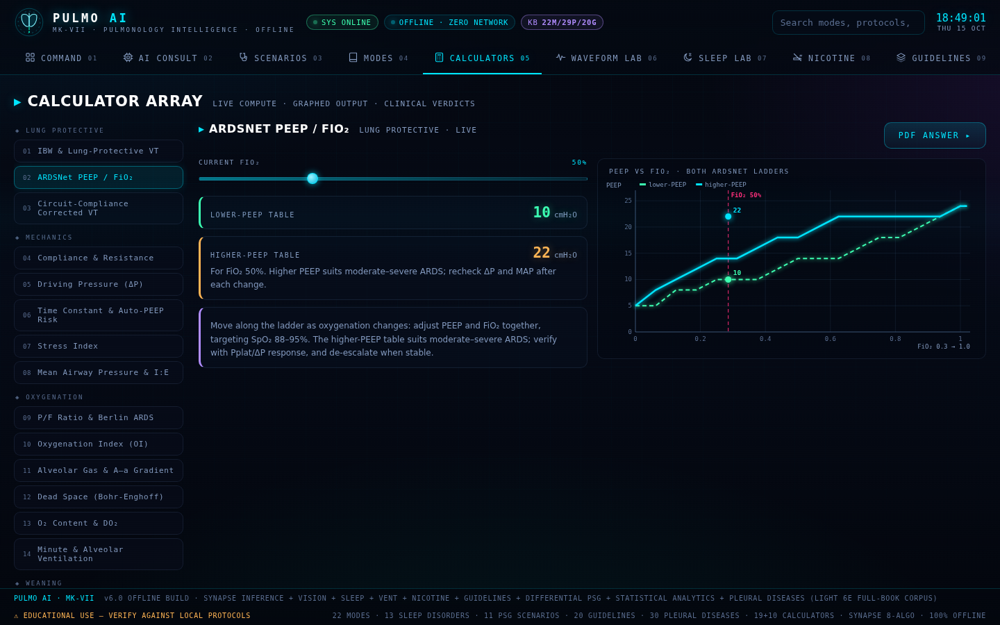
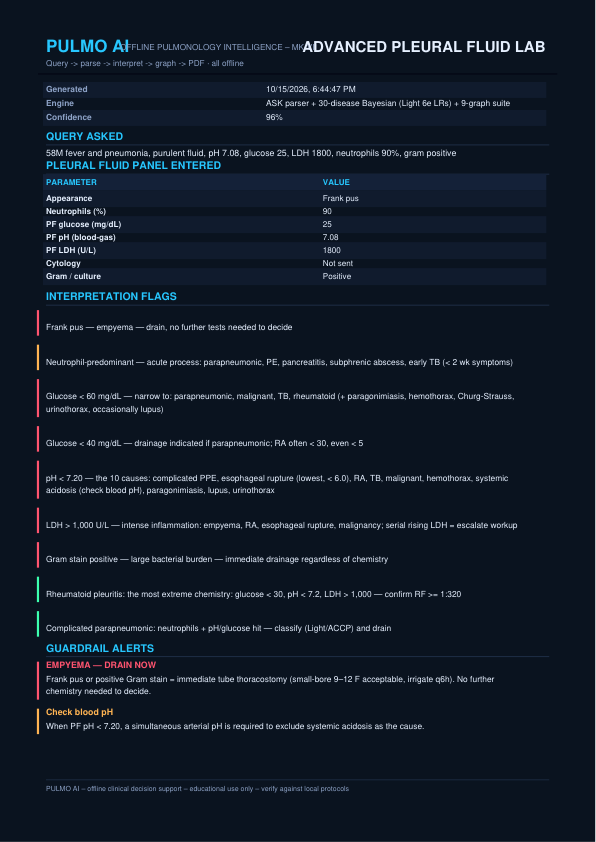
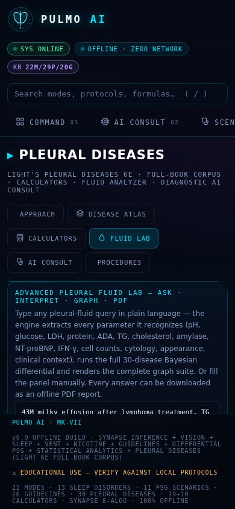

# 🫁 PULMO AI — MK-VII

**A complete pulmonary & critical-care medicine workstation in a single HTML file.**
Fully offline. Zero dependencies. No server. No telemetry. No internet — ever.

| | |
|---|---|
| **App** | `PULMO-AI.html` — one file, ~2.3 MB, double-click to run |
| **Mode** | 100% offline · works from `file://` · zero external requests |
| **Stack** | Vanilla JS · hand-rolled engines · no CDN, no build requirement |
| **License** | MIT |

---

## What's inside

| Module | Highlights |
|---|---|
| **🫁 Ventilator** | 42-rule management engine, 19 graphed calculators (driving pressure, compliance, ΔP, I:E, weaning indices), waveform scalar/loop analytics with auto-PEEP & overdistention detection, equation-of-motion lecture figures |
| **😴 Sleep (PSG)** | Full PSG simulator (stage architecture, hypopneas, arousals, SpO₂ desats), AHI/ODI/RDI indices, 15-disorder Bayesian differential, AASM module corpus (20 guideline modules), PAP mode selector incl. ASV/SERVE-HF logic, split-night & MSLT sequencing |
| **🚭 Smoking** | Cessation protocols, pharmacotherapy matching, relapse-risk profiling |
| **💊 Guidelines** | 20 guideline modules across 23 domains, full-text search |
| **🫀 Pleural Diseases** | Built from a complete 522-page scan of *Light's Pleural Diseases* (6th ed.): 30-disease searchable atlas, 8-step approach algorithm, 10 graphed calculators, 5 procedure guides, 4-layer consult engine (guardrails → Bayesian log-odds → structural constraints → next-step ladder) |
| **🧪 Advanced Pleural Fluid Lab** | Free-text query parser — type *"58M, pneumonia, purulent fluid, pH 7.08, glucose 25, LDH 1800, neutrophils 90%"* and get a 9-graph diagnostic suite: radar signature, pH×glucose disease-zone map, Light-space quadrants, ADA×lymphocyte TB map, Bayesian differential, evidence heatmap, Fagan ladder, cell-differential stacks |
| **🧠 Synapse** | 8-algorithm inference ensemble (rule induction, fuzzy trapezoids, Bayesian log-odds, neural action lattice, DTW, autocorrelation, z-scores, confidence calibration) + offline computer-vision pipeline for ventilator trace screenshots (no OCR) |
| **📄 PDF Answer Engine** | **Every calculator can answer any query as a generated PDF** — a raw, zero-dependency PDF writer renders the answer with the live graphs embedded. Works from `file://`. |
| **🔍 AI Consult** | Patient data + history + imaging + lab parameters → ranked diagnosis with differentials, confidence, and management steps |

---

## Screenshots

| Advanced Fluid Lab — graphs | Fluid Lab — ASK + results |
|---|---|
|  |  |

| PDF answer button in any calculator | Generated PDF (page 1) | Mobile 390 px |
|---|---|---|
|  |  |  |

---

## Run it

Three equivalent ways:

1. **Download & double-click** — grab [`PULMO-AI.html`](PULMO-AI.html) and open it in any browser. That's the whole app.
2. **GitHub Pages** (if enabled) — the live URL serves the same file via `index.html`.
3. **Build from source**:

   ```bash
   git clone https://github.com/<owner>/pulmo-ai.git
   cd pulmo-ai
   node src/build_offline.js     # regenerates PULMO-AI.html at the repo root
   ```

   The build base64-inlines the lecture figures, concatenates 39 source parts,
   syntax-checks every script block, and writes the single-file app.

---

## Repository layout

```
PULMO-AI.html        ← the app (committed build output — this IS the product)
index.html            ← GitHub Pages redirect
src/
  build_offline.js    ← single-file assembler (repo-relative, runs anywhere)
  vai-engine.bundle.js← offline inference engine bundle
  vai2-parts/         ← all 39 application source parts (p01–p24)
public/               ← build inputs: lecture figures, logo, robots.txt
tools/                ← the book-processing pipeline used to build the Pleural module
                        (PyMuPDF extraction + resumable Tesseract OCR + digest)
docs/                 ← screenshots + a sample PDF generated by the answer engine
```

## How the Pleural module was built

`tools/` contains the actual pipeline that scanned *Light's Pleural Diseases*
(6th edition, 522 pages): native-text extraction (PyMuPDF), a resumable
checkpointed OCR pass for the 265 scanned pages (Tesseract), chapter
splitting, and a clinical digest that distilled the book into threshold
tables, likelihood ratios, and disease signatures. **No book text is
included in this repository** — only the distilled medical facts that drive
the engines.

---

## Medical disclaimer

PULMO AI is an educational and clinical-support tool. It is **not** a
medical device and must never be used as the sole basis for diagnosis or
treatment. Always verify outputs against current guidelines and local
clinical judgment.

## License

MIT — see [LICENSE](LICENSE).
